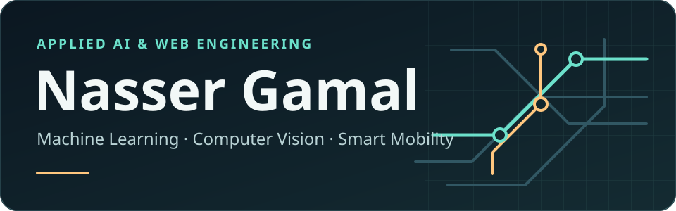
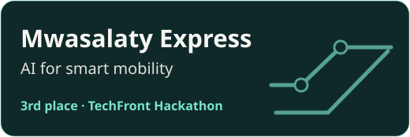
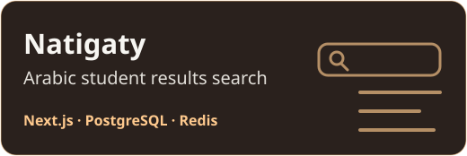

# Nasser Gamal · ناصر جمال

**AI & Machine Learning student at Arab Open University · Founder and developer of Mwasalaty Express**

[Portfolio](https://github.com/nassergamale1-sketch/nasser-portfolio) · [LinkedIn](https://www.linkedin.com/in/nasser-gamal) · [Public repositories](https://github.com/nassergamale1-sketch?tab=repositories)

I work on smart mobility, computer vision, and Arabic-language web apps. I built Mwasalaty Express as the project's sole developer and completed *Introduction to AI with Python* at The American University in Cairo.

أنا ناصر جمال، طالب ذكاء اصطناعي وتعلّم آلة في الجامعة العربية المفتوحة. أسست وطوّرت «مواصلاتي إكسبريس»، وبشتغل على مشاريع في الرؤية الحاسوبية وتطبيقات الويب بالعربي.

## Selected work · المشاريع

**Mwasalaty Express (مواصلاتي)** is an AI-powered smart mobility project I founded and built. It earned **3rd place at the TechFront Hackathon** at Arab Open University. I filed a patent application with Egypt’s Academy of Scientific Research and Technology. [View the repository](https://github.com/nassergamale1-sketch/Mwasalaty_EX)

**Natigaty (نتيجتي)** lets students look up Egyptian secondary school results by seat number or name. It uses indexed search in PostgreSQL, Redis caching, and a batch import pipeline. [View the repository](https://github.com/nassergamale1-sketch/natigaty)

## Toolkit · التقنيات

| Area | Tools |
| --- | --- |
| AI and computer vision | Python · OpenCV · YOLO |
| Web development | JavaScript · React · Next.js · Node.js |
| Data and deployment | PostgreSQL · Redis · Docker |

## Let’s connect · تواصل معي

I’m open to AI and machine learning internships and collaborations in computer vision and smart mobility.

[Connect on LinkedIn](https://www.linkedin.com/in/nasser-gamal)
